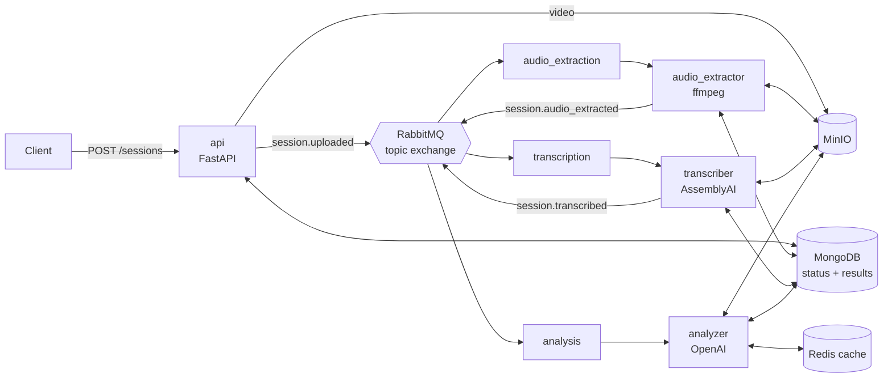

# Psychology Session Analyzer


Event-driven microservices that turn a recorded therapy session into structured insights:
who the patient is, what topics they talk about, and which emotions they express.

## Architecture



| Service | Role |
|---|---|
| `api` | Upload videos, track status, read results and aggregate stats |
| `audio_extractor` | Extracts a mono 16 kHz MP3 with ffmpeg |
| `transcriber` | Speaker-labelled transcript (AssemblyAI) |
| `analyzer` | Identifies the patient and tags each sentence with topic, emotion and valence (OpenAI), caching results in Redis |

## Reliability design

- **At-least-once delivery.** Durable queues, persistent messages, manual acks, `prefetch_count=1`.
- **Delayed retries.** A failed message goes to `<queue>.retry`, which holds it for 5 s (message TTL) and dead-letters it back to the work queue. The attempt count travels in an `x-retry-count` header.
- **Dead-letter queues.** After 3 retries, or immediately for bad input such as a video with no audio track, the message lands in `<queue>.dlq` and the session is marked `FAILED` with the error.
- **Idempotent stages.** Each session has a status in MongoDB (`UPLOADED → AUDIO_EXTRACTED → TRANSCRIBED → ANALYZED`). A worker only processes a message whose session is waiting for its stage; if a worker crashed after saving its output but before publishing, the redelivered message just re-publishes the next event.
- **Safe storage keys.** Objects are stored under server-generated session IDs, never user filenames.
- **Graceful cache failure.** If Redis is down the analyzer keeps working without the cache.

Known limitation: the status update and the next event are not atomic. A crash between them is recovered by redelivery, but a production system would use a transactional outbox.

## Run it

Requires Docker. No API keys needed: `FAKE_AI=true` (the default) swaps AssemblyAI and OpenAI for deterministic fakes.

```bash
make up      # build and start everything, wait for healthchecks
make smoke   # upload samples/sample_session.mp4 and wait for the analysis
make down
```

To use the real models, copy `.env.example` to `.env`, set `FAKE_AI=false` and add `OPENAI_API_KEY` and `ASSEMBLYAI_API_KEY`.

| URL | What |
|---|---|
| http://localhost:8000/docs | API (Swagger UI) |
| http://localhost:15672 | RabbitMQ management (guest/guest) |
| http://localhost:9001 | MinIO console (minio/minio123) |

## API

```bash
curl -F "file=@session.mp4;type=video/mp4" http://localhost:8000/sessions   # → {"session_id": "...", "status": "UPLOADED"}
curl http://localhost:8000/sessions/<id>            # status
curl http://localhost:8000/sessions/<id>/analysis   # per-sentence topic/emotion/valence + summaries
curl http://localhost:8000/stats/topics             # MongoDB aggregation across all sessions
curl http://localhost:8000/stats/emotions
```

## Development

```bash
python3.11 -m venv .venv && source .venv/bin/activate
pip install -r requirements-dev.txt
make test lint
```

Unit tests use mongomock, fakeredis and in-memory fakes for RabbitMQ and MinIO, so they run without Docker. CI runs lint and unit tests, then starts the full stack with Docker Compose and runs the end-to-end smoke test.

## Project layout

```
libs/common/       shared config, MongoDB repository, MinIO storage, RabbitMQ messaging
services/<name>/   one folder per microservice, each with its own Dockerfile
tests/             unit tests for all services
scripts/           end-to-end smoke test
```
